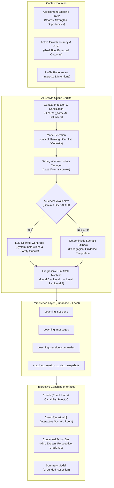
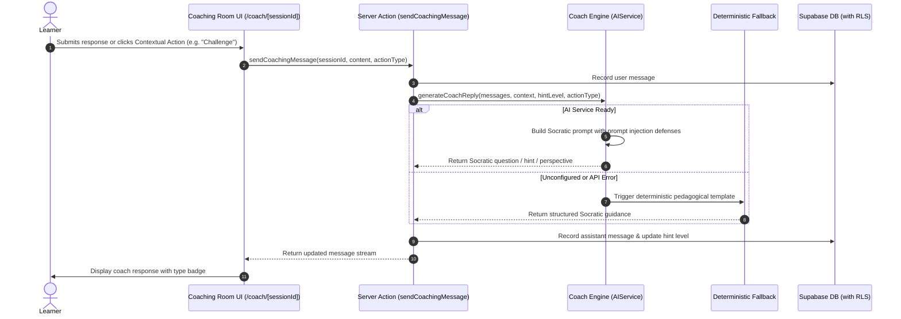

# OBHASH — AI Growth Coach Architecture

**Phase:** Phase 5 of 8 (AI Growth Coach)  
**System:** Socratic Mentorship & Guided Thinking Engine  
**Philosophy:** Human-Centered Intelligence  

---

## 1. Architectural Overview

The AI Growth Coach is OBHASH's core conversational thinking partner. Unlike conventional AI chatbots designed to produce quick answers or complete cognitive work for users, the Growth Coach is engineered to **strengthen the learner's own reasoning ability**.

The system separates conversational coaching into distinct operational layers:
1. **Context Ingestion:** Securely retrieves the learner's assessment baseline, active growth journey, and targeted goals.
2. **Coaching Mode Selection:** Applies specialized Socratic instructions tailored to *Critical Thinking*, *Creative Problem-Solving*, or *Curiosity*.
3. **Progressive Hint Engine:** Tracks and delivers 4-tier progressive hints (Levels 0 to 3) without prematurely giving away solutions.
4. **Contextual Action Dispatcher:** Handles explicit user metacognitive actions (`hint`, `explain`, `perspective`, `challenge`, `summarize`).
5. **Grounded Session Synthesizer:** Compiles structured post-session summaries derived strictly from observable discussion transcripts.

---

## 2. Interaction Sequence

---

## 3. Strict Scope Isolation

- **Phase 5 Delivers:** Socratic dialogue, progressive hints, capability modes, contextual actions, and grounded session summaries.
- **Phase 6 (Challenge Workspace):** Will provide interactive simulation environments for executing planned challenges.
- **Phase 7 (Growth Portfolio):** Will quantify independent performance growth deltas.
