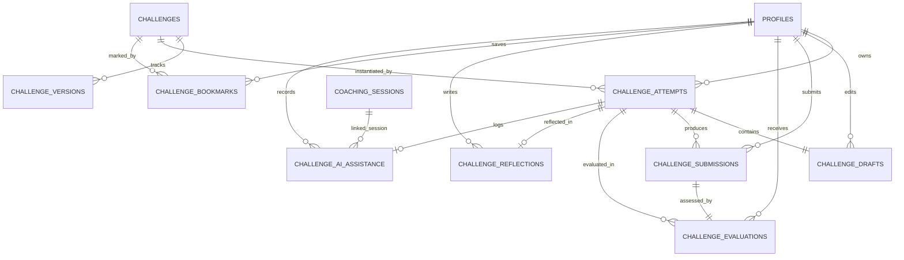

# OBHASH Challenge Database Schema & Architecture

**Phase:** Phase 6 of 8 (Challenge & Reflection Workspace)  
**Migration ID:** `20261120050000_phase6_challenges.sql`  
**Storage Engine:** Supabase PostgreSQL with Row Level Security (RLS)

---

## 1. Entity-Relationship Overview



---

## 2. Table Specifications

### 2.1 `public.challenges`
Master catalog of published practice challenges.
- `id` (TEXT, PK): Unique challenge identifier (e.g. `ct-unproven-claim`).
- `title` (TEXT): Branded display title.
- `slug` (TEXT, UNIQUE): URL-friendly slug.
- `short_description` (TEXT): Summary displayed in catalog and cards.
- `detailed_instructions` (TEXT): Step-by-step task briefing.
- `capability_category` (TEXT): `critical-thinking`, `creative-problem-solving`, or `curiosity`.
- `relevant_dimensions` (TEXT[]): Specific Phase 3 dimensions exercised.
- `difficulty` (TEXT): `beginner`, `intermediate`, or `advanced`.
- `estimated_completion_time` (TEXT): Recommended time budget (e.g. `20–25 min`).
- `learning_objective` (TEXT): Target developmental outcome.
- `scenario` (TEXT): Rich real-world situation or problem context.
- `required_deliverables` (JSONB): Array of deliverable specs with titles, placeholders, and word count targets.
- `suggested_thinking_steps` (TEXT[]): Heuristic thinking process.
- `optional_resources` (JSONB): Mental models, heuristics, and frameworks.
- `reflection_prompts` (TEXT[]): Metacognitive reflection questions.
- `version` (INTEGER): Catalog schema version (default 1).
- `is_published` (BOOLEAN): Visibility flag.

### 2.2 `public.challenge_attempts`
Tracks a user's engagement with a challenge.
- `id` (TEXT, PK): Attempt ID (e.g. `attempt-xxx`).
- `user_id` (UUID, FK -> `profiles.id`): Learner identity.
- `challenge_id` (TEXT, FK -> `challenges.id`): Associated challenge.
- `challenge_version` (INTEGER): Version active at attempt inception.
- `status` (TEXT): `not_started`, `in_progress`, `submitted`, `evaluating`, `evaluated`, `reflection_pending`, `completed`, `abandoned`.
- `journey_activity_id` (TEXT, Nullable): Linked Phase 4 planned activity ID.
- `started_at`, `submitted_at`, `completed_at` (TIMESTAMPTZ).

### 2.3 `public.challenge_drafts`
Live, autosaved working state.
- `id` (UUID, PK): Draft ID.
- `attempt_id` (TEXT, UNIQUE, FK -> `challenge_attempts.id`): Single active draft per attempt.
- `user_id` (UUID, FK -> `profiles.id`).
- `notes` (TEXT): Working notes and scratchpad thinking.
- `deliverables` (JSONB): Map of deliverable ID -> user-authored content.
- `last_saved_at` (TIMESTAMPTZ).

### 2.4 `public.challenge_submissions`
Immutable record of submitted work.
- `id` (UUID, PK).
- `attempt_id` (TEXT, FK -> `challenge_attempts.id`).
- `user_id` (UUID, FK -> `profiles.id`).
- `challenge_id` (TEXT).
- `challenge_version` (INTEGER).
- `notes_snapshot` (TEXT).
- `deliverables_snapshot` (JSONB).
- `submission_number` (INTEGER).
- `submitted_at` (TIMESTAMPTZ).

### 2.5 `public.challenge_evaluations`
Evidence-grounded rubric feedback.
- `id` (UUID, PK).
- `submission_id` (UUID, FK -> `challenge_submissions.id`).
- `attempt_id` (TEXT, FK -> `challenge_attempts.id`).
- `user_id` (UUID, FK -> `profiles.id`).
- `evaluator_type` (TEXT): `ai`, `deterministic_fallback`, `human_rubric`.
- `evaluator_version` (TEXT): e.g. `1.0`.
- `strengths` (JSONB): Observable strengths list.
- `growth_opportunities` (JSONB): Developmental frontiers list.
- `evidence_citations` (JSONB): Quotes from actual user text with claims and analyses.
- `alternative_perspectives` (JSONB): Counter-angles and adjacent heuristics.
- `recommended_next_steps` (JSONB): Next developmental recommendations.
- `dimension_evaluations` (JSONB): 4-level rubric scores and evidence per relevant dimension.
- `confidence_score` (NUMERIC(3, 2)): Evaluator confidence (0.0 to 1.0).
- `evidence_sufficiency` (TEXT): `sufficient`, `partial`, or `insufficient`.

### 2.6 `public.challenge_reflections`
Metacognitive reflection record.
- `id` (UUID, PK).
- `attempt_id` (TEXT, UNIQUE, FK -> `challenge_attempts.id`).
- `user_id` (UUID, FK -> `profiles.id`).
- `challenge_id` (TEXT).
- `responses` (JSONB): Map of prompt -> reflection answer.
- `is_submitted` (BOOLEAN).
- `submitted_at` (TIMESTAMPTZ).

### 2.7 `public.challenge_bookmarks`
Saved challenges for later practice.
- `id` (UUID, PK).
- `user_id` (UUID, FK -> `profiles.id`).
- `challenge_id` (TEXT, FK -> `challenges.id`).
- `UNIQUE(user_id, challenge_id)`.

### 2.8 `public.challenge_ai_assistance_records`
Auditable metadata of AI Coach consultations during the challenge.
- `id` (UUID, PK).
- `attempt_id` (TEXT, FK -> `challenge_attempts.id`).
- `user_id` (UUID, FK -> `profiles.id`).
- `coaching_session_id` (UUID, Nullable, FK -> `coaching_sessions.id`).
- `queries_count` (INTEGER): Number of times coach was asked for guidance.
- `hint_levels_used` (INTEGER[]): Array of hint levels unlocked (e.g. `[1, 2]`).
- `action_types_used` (TEXT[]): Socratic actions invoked (e.g. `['hint', 'challenge']`).
- `assistance_summary` (TEXT): Summary of coaching consultations.

---

## 3. Row Level Security (RLS) Policies

All user-owned tables enforce `auth.uid() = user_id`:
```sql
ALTER TABLE public.challenge_attempts ENABLE ROW LEVEL SECURITY;
CREATE POLICY "Users can manage their own challenge attempts"
    ON public.challenge_attempts FOR ALL
    USING (auth.uid() = user_id) WITH CHECK (auth.uid() = user_id);

ALTER TABLE public.challenge_drafts ENABLE ROW LEVEL SECURITY;
CREATE POLICY "Users can manage their own drafts"
    ON public.challenge_drafts FOR ALL
    USING (auth.uid() = user_id) WITH CHECK (auth.uid() = user_id);

ALTER TABLE public.challenge_submissions ENABLE ROW LEVEL SECURITY;
CREATE POLICY "Users can manage their own challenge submissions"
    ON public.challenge_submissions FOR ALL
    USING (auth.uid() = user_id) WITH CHECK (auth.uid() = user_id);

ALTER TABLE public.challenge_evaluations ENABLE ROW LEVEL SECURITY;
CREATE POLICY "Users can view their own challenge evaluations"
    ON public.challenge_evaluations FOR SELECT
    USING (auth.uid() = user_id);

ALTER TABLE public.challenge_reflections ENABLE ROW LEVEL SECURITY;
CREATE POLICY "Users can manage their own reflections"
    ON public.challenge_reflections FOR ALL
    USING (auth.uid() = user_id) WITH CHECK (auth.uid() = user_id);
```
