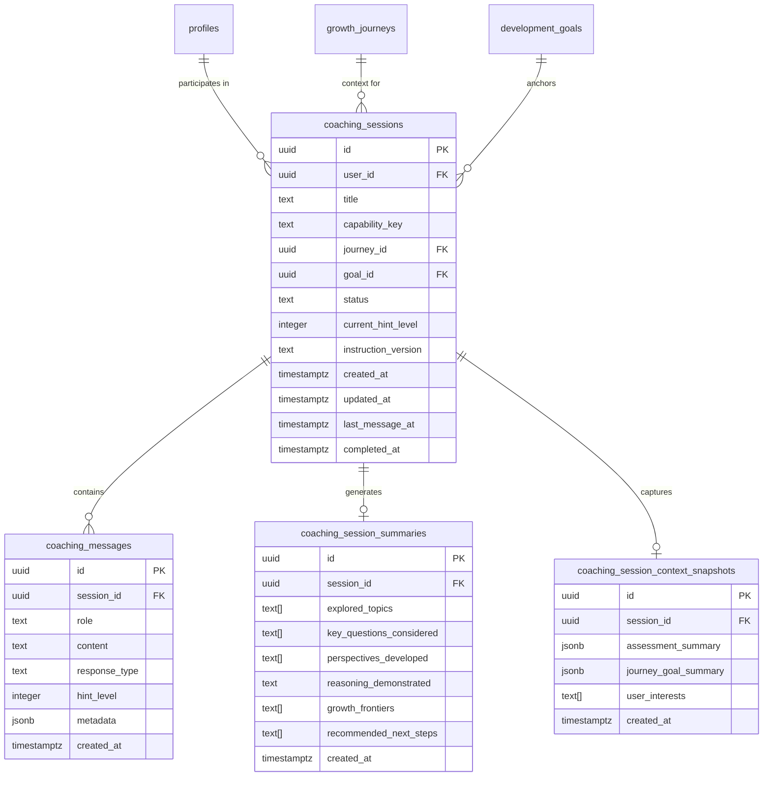

# OBHASH — Coaching Database Reference

**Phase:** Phase 5 of 8 (AI Growth Coach)  
**Migration ID:** `20261120040000_phase5_ai_coach.sql`  

---

## 1. Relational Entity-Relationship Diagram

---

## 2. Row Level Security (RLS) Policies

All tables enforce strict user ownership:
1. `coaching_sessions`: `auth.uid() = user_id` for all operations.
2. `coaching_messages`: Protected via `EXISTS (SELECT 1 FROM coaching_sessions WHERE id = session_id AND user_id = auth.uid())`.
3. `coaching_session_summaries`: Protected via `EXISTS` subquery verifying session ownership.
4. `coaching_session_context_snapshots`: Protected via `EXISTS` subquery verifying session ownership.
