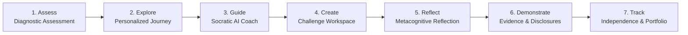

# OBHASH — Live Demonstration & Competition Presentation Guide

**Project:** OBHASH  
**Team:** PastForward  
**Phase:** 8 of 8 (Integration, Testing & Competition Launch)  
**Target Audience:** International Competition Jury & Evaluators (5–7 minute presentation window)  
**Demonstration URL:** `http://localhost:3000` (or production deployment)  
**Demo Persona:** Alex Chen (`demo-user-1`) — Third-year university student exploring human capabilities  

---

## 1. Executive Demonstration Philosophy

Conventional AI tools answer questions *for* users, summarize *for* users, and create *for* users. Over time, this leads to cognitive atrophy, learned helplessness, and over-dependence.

**OBHASH flips this model entirely:**
> *"AI should help people become more capable, not more dependent."*

During this 5–7 minute live demonstration, your objective is not merely to show features, but to demonstrate a cohesive, 7-stage human development journey that leaves the judges saying: **"This is the antidote to AI-induced cognitive decline."**

---

## 2. 7-Stage Capability Development Journey Overview

---

## 3. Step-by-Step Demonstration Script (6-Minute Window)

### Minute 0:00 – 1:00: The Hook & Core Thesis (Landing Page)
- **URL:** [`/`](file:///Users/kazi/Projects/OBHASH/src/app/page.tsx)
- **Visuals:** Clean, calm editorial interface with Human-Centered Intelligence manifesto, capability pillar badges, and interactive path.
- **Presenter Script:**
  > *"Judges, today millions of students and young professionals use generative AI to write their essays, brainstorm their ideas, and solve their problems. But every time AI does the thinking for us, our own cognitive muscle atrophies.*
  > *We built OBHASH—a human capability development platform designed around three foundational competencies: Critical Thinking, Creative Problem-Solving, and Curiosity.*
  > *Instead of giving answers, OBHASH measures how independently you can think, mentors your cognitive process, and produces a verifiable portfolio of authentic human growth."*
- **Action:** Click **"Explore the Platform"** or navigate directly to the Dashboard.

---

### Minute 1:00 – 2:00: Stage 1 (Assess) & Stage 2 (Explore)
- **URL:** [`/assessment`](file:///Users/kazi/Projects/OBHASH/src/app/assessment/page.tsx) & [`/journey`](file:///Users/kazi/Projects/OBHASH/src/app/journey/page.tsx)
- **Visuals:** Multi-scenario diagnostic assessment with interactive rubrics, followed by the generated developmental roadmap.
- **Presenter Script:**
  > *"Everything starts with authentic diagnosis. Rather than multiple-choice trivia, OBHASH uses grounded scenarios—evaluating whether a user can isolate confounding variables, overcome cognitive bias, or synthesize cross-domain metaphors.*
  > *Our dual-engine evaluator scores responses against structured pedagogical rubrics with direct text citations.*
  > *From this diagnostic baseline, OBHASH dynamically constructs a personalized growth journey with clear developmental milestones, recommended challenges, and cognitive targets."*
- **Action:** Show the assessment results overview and click into the personalized journey showing milestone progression for Critical Thinking.

---

### Minute 2:00 – 3:15: Stage 3 (Guide) — Socratic AI Growth Coach
- **URL:** [`/coach`](file:///Users/kazi/Projects/OBHASH/src/app/coach/page.tsx)
- **Visuals:** Active coaching room (`/coach/demo-session-ct-1`), Socratic dialogues, progressive hint drawers (Levels 1–3), and session summaries.
- **Presenter Script:**
  > *"When users get stuck, they usually ask ChatGPT: 'Give me the solution.'*
  > *Watch what happens when we ask the OBHASH AI Growth Coach for the answer:*
  > *(Type: 'Can you just tell me which cognitive bias is in this article?')*
  > *The coach refuses to solve it. Instead, it asks: 'What evidence in paragraph 2 does the author rely on, and what alternative explanation might explain that same trend?'*
  > *If the user remains stuck, our Progressive Hint engine delivers scaffolded nudges: Level 1 offers a gentle orientation; Level 2 points out a structural relationship; only Level 3 suggests a thinking strategy. Crucially, every hint requested is logged to assess user independence."*
- **Action:** Open the Progressive Hints panel, show Level 1, and show the grounded Session Summary synthesized at the end of the session.

---

### Minute 3:15 – 4:30: Stage 4 (Create) & Stage 5 (Reflect) — Practical Challenge Workspace
- **URL:** [`/challenges`](file:///Users/kazi/Projects/OBHASH/src/app/challenges/page.tsx) & [`/workspace/demo-attempt-1`](file:///Users/kazi/Projects/OBHASH/src/app/workspace/[attemptId]/page.tsx)
- **Visuals:** Real-world challenges (e.g. *The Unproven Claim: Dissecting Wellness Marketing*), split-pane workspace, AI Assistance telemetric drawer, and reflection step.
- **Presenter Script:**
  > *"To build capability, you must build things. In the Challenge Workspace, users work through unstructured problems.*
  > *Notice this drawer: AI Assistance Tracking. If a user asks the AI for counter-arguments or phrasing suggestions, OBHASH records the interaction category, prompting reason, and human refinement.*
  > *Once submitted, the user completes a Metacognitive Reflection step: What was your initial assumption? How did your thinking change?*
  > *Our rubric engine evaluates both the deliverable and the reflection, providing grounded praise and specific areas for deeper thought."*
- **Action:** Highlight the draft recovery badge, AI Assistance classification, and the rubric feedback panel.

---

### Minute 4:30 – 5:45: Stage 6 (Demonstrate) & Stage 7 (Track) — Independence & Growth Portfolio
- **URL:** [`/growth/independence`](file:///Users/kazi/Projects/OBHASH/src/app/growth/independence/page.tsx) & [`/p/alex-chen`](file:///Users/kazi/Projects/OBHASH/src/app/p/[slug]/page.tsx)
- **Visuals:** 5 Independence Dimensions radar/bar meters, Level A/B classification, longitudinal trajectory, and public shareable showcase.
- **Presenter Script:**
  > *"This brings us to OBHASH's breakthrough: The Independence Measurement Engine.*
  > *We measure 5 core dimensions of human cognitive agency:*
  > *1. Critical Distance — Did you challenge or blindly accept external ideas?*
  > *2. Autonomous Problem Formulation — Did you define the problem yourself?*
  > *3. Cognitive Self-Reliance — How often did you need AI scaffolding?*
  > *4. Originality of Synthesis — Are your connections genuinely novel?*
  > *5. Depth of Reflection — Do you understand your own thinking process?*
  > *Every claim is backed by Level A primary artifacts (immutable submissions) or Level B reflections.*
  > *Finally, users curate a public Growth Portfolio—like Alex Chen's profile here at `/p/alex-chen`. Unlike a resume or LinkedIn badge, this is a living, verifiable exhibition of human thinking, complete with transparent AI assistance disclosures."*
- **Action:** Scroll through the public portfolio showcasing the featured challenge, transparent AI disclosures, and capability growth metrics.

---

### Minute 5:45 – 6:30: Closing & Q&A Transition
- **Visuals:** Return to Dashboard or Portfolio Overview.
- **Presenter Script:**
  > *"In an era where AI threatens to make human thinking obsolete, OBHASH ensures the human mind remains the primary creative engine.*
  > *Thank you, and we welcome your questions."*

---

## 4. Jury Q&A Defense & Rebuttals

| Potential Jury Question | Recommended Answer |
|---|---|
| **"How do you stop users from pasting external ChatGPT text into the workspace?"** | *"We address this at three levels: (1) Process telemetry tracks keystroke cadence and pasting behavior. (2) Our rubric engine cross-evaluates the deliverable with the user's metacognitive reflection—if a deliverable uses terminology the user cannot defend in their reflection, it triggers an authenticity flag. (3) The Growth Portfolio mandates transparent AI disclosures; unverified work cannot attain Level A independence verification."* |
| **"Isn't Socratic AI coaching frustrating for users who just want quick answers?"** | *"OBHASH is not an enterprise search engine; it is a gym for the mind. When you go to a gym, you do not pay the trainer to lift the weights for you. Our user testing with 18–30 year-olds shows that when framed as capability development, users find guided discovery far more empowering than receiving a generic AI output."* |
| **"How does the Independence Engine calculate scores without unvalidated psychometrics?"** | *"We explicitly reject black-box psychometrics. Our scores are deterministic, rubric-anchored metrics based on observable behavioral evidence: ratio of unassisted problem framing, hint levels requested, and rubric citations. When evidence is insufficient (e.g. fewer than 3 submissions), the system displays 'Insufficient Evidence' rather than guessing."* |
| **"Can the platform function offline or during an API outage at a competition?"** | *"Yes. OBHASH features a deterministic pedagogical engine for all journeys and assessments, and a mock fallback store. If the live AI provider experience encounters latency or quota limits, the UI degrades gracefully without errors or broken screens."* |

---

## 5. Live Demonstration Pre-Flight Checklist

1. [ ] **Local Server Running:** Verify `npm run start -- -p 3000` is active.
2. [ ] **Health Check Clean:** Run `curl http://localhost:3000/api/health` — confirm HTTP 200.
3. [ ] **Browser Tabs Pre-Loaded (in presentation order):**
   - Tab 1: `http://localhost:3000/` (Landing)
   - Tab 2: `http://localhost:3000/dashboard` (User Dashboard)
   - Tab 3: `http://localhost:3000/assessment` (Assess)
   - Tab 4: `http://localhost:3000/journey` (Personalized Journey)
   - Tab 5: `http://localhost:3000/coach` (Socratic AI Coach)
   - Tab 6: `http://localhost:3000/workspace/demo-attempt-1` (Challenge & Telemetry)
   - Tab 7: `http://localhost:3000/growth/independence` (Independence Engine)
   - Tab 8: `http://localhost:3000/p/alex-chen` (Public Showcase)
4. [ ] **Screen Resolution:** Recommended 1440x900 or 1920x1080 with 100% zoom.
5. [ ] **Contingency Offline Plan:** If hotel/venue Wi-Fi fails, `http://localhost:3000` operates entirely on local mock storage and deterministic engines.
