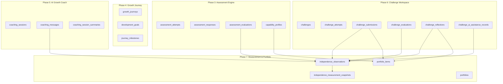

# OBHASH Evidence Architecture

## 1. Overview and Philosophy

The OBHASH capability platform operates on a **zero-fabrication, traceable evidence model**. Rather than storing opaque or mutable numeric aggregates that overwrite history, all capability insights and independence measurements are derived from verifiable source artifacts generated throughout Phases 1–6.

---

## 2. Integrated Evidence Sources



### 2.1 Phase 3: Diagnostic Assessment Evidence
- **Source Artifacts:** `assessment_evaluations` & `capability_profiles`.
- **Measurement Role:** Diagnostic baseline establishing initial demonstrated proficiency across Critical Thinking, Creative Problem-Solving, and Curiosity under structured prompt conditions.
- **Provenance Link:** Referenced by `eval-ct-baseline` and rubric version tags.

### 2.2 Phase 4: Growth Journey Evidence
- **Source Artifacts:** `development_goals`, `journey_milestones`, `journey_capability_focus_areas`.
- **Measurement Role:** Contextual intentionality. Establishes learner self-selected growth directions and tracks milestone completion.
- **Rule:** A planned milestone is an intention, not proof of capability, until supported by active challenge practice or diagnostic completion.

### 2.3 Phase 5: Socratic Coaching Evidence
- **Source Artifacts:** `coaching_messages`, `coaching_sessions`, `coaching_session_summaries`.
- **Measurement Role:** Evaluates conversational reasoning, prompt selectivity, and reaction to progressive hints (Levels 1–4).
- **Rule:** Coach exchanges are evaluated in conjunction with hint levels used. If the coach provided a Level 4 direct answer, subsequent user responses cannot be credited as independent.

### 2.4 Phase 6: Practical Challenge Evidence
- **Source Artifacts:** `challenge_submissions`, `challenge_evaluations`, `challenge_reflections`, `challenge_ai_assistance_records`.
- **Measurement Role:** Highest-fidelity evidence. Demonstrates open-ended problem solving under real constraints, authentic deliverables, lateral cognitive flexibility, and post-task metacognitive reflection.
- **Provenance Link:** Referenced by submission ID (`sub-...`) and immutable deliverable snapshots.

---

## 3. Evidence Provenance Record Schema

Every observation registered in `independence_observations` adheres to strict provenance tracking:

```typescript
interface IndependenceObservation {
  id: string;                          // Unique observation UUID
  userId: string;                      // Learner owner UUID
  dimensionKey: IndependenceDimensionKey; // Target dimension
  behaviorKey: string;                 // Indicator code (e.g., 'identifies_assumptions')
  behaviorDescription: string;         // Human-readable behavioral synthesis
  sourceType: IndependenceSourceType;  // 'challenge_submission' | 'challenge_reflection' | 'assessment_evaluation' | 'coaching_session'
  sourceRecordId: string;              // Foreign key to source artifact
  sourceTitle: string;                 // Human-readable title of activity
  evidenceQuote?: string;              // Direct verbatim quotation from learner work
  evidenceAnalysis?: string;           // Evaluative rationale justifying the observation
  aiAssistanceClassification: AIAssistanceLevel; // 'Level A' through 'Level E'
  aiAssistanceNotes?: string;          // Details on assistance telemetry
  confidenceScore: number;             // Confidence rating (0.0 to 1.0)
  observedAt: string;                  // ISO 8601 timestamp of source event
  createdAt?: string;                  // System record timestamp
}
```

---

## 4. Evidence Sufficiency States

The engine calculates evidence sufficiency deterministically:

1. **Insufficient Evidence (< 2 qualified observations):**
   - The system acknowledges absence of sufficient data.
   - Refuses to display speculative progress bars or rankings.
   - Displays clear educational cards guiding the learner to complete a diagnostic or challenge.
2. **Emerging Evidence (2–3 observations):**
   - Early signals observed within a single context or task type.
   - Acknowledges that behavior may not yet be generalized.
3. **Developing Evidence (4–6 observations):**
   - Observations span multiple activities or distinct capability domains.
   - Shows observable patterns of assumption isolation and independent design.
4. **Consistent Evidence (7+ observations):**
   - Robust, multi-context stability with demonstrated independent execution and disciplined AI partnership.
