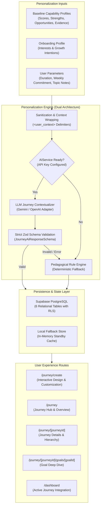
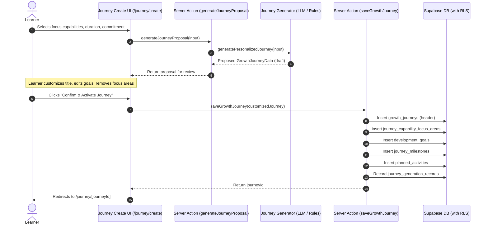

# OBHASH — Growth Journey Architecture

**Phase:** Phase 4 of 8 (Personalized Growth Journey)  
**System:** Personalized Capability Development Engine  
**Philosophy:** Human-Centered Intelligence  

---

## 1. Architectural Overview

The Growth Journey Engine is the foundational system responsible for translating raw capability assessment evidence and user preferences into a structured, achievable, and adaptable development roadmap.

Unlike conventional AI tools that produce generic advice or prescribe static curricular checklists, the OBHASH Growth Journey Engine adheres to three architectural imperatives:

1. **Evidence-Informed Personalization:** Recommendations are grounded in demonstrated performance across the 15 capability dimensions evaluated in Phase 3.
2. **Strength-Based Growth:** Development goals leverage existing strengths as cognitive anchors to support adjacent developmental opportunities, rather than merely punishing low scores.
3. **User Agency and Co-Creation:** The user reviews, customizes, refines, and explicitly confirms proposed journeys before activation.

---

## 2. Component Interactions & Sequence

The journey creation and lifecycle workflow operates through modern Next.js Server Actions:

---

## 3. Scope Boundaries & Future Phase Isolation

- **Phase 4 Delivers:** Structured journey plans, hierarchy, milestones, planned activities, recommendation reasoning, and status tracking (`not_started`, `in_progress`, `completed`, `skipped`).
- **Phase 5 (AI Growth Coach):** Will integrate conversational coaching into goals and activities.
- **Phase 6 (Challenge Workspace):** Will provide interactive execution environments for planned activities.
- **Phase 7 (Growth Portfolio):** Will calculate evidence-based longitudinal improvement deltas.
