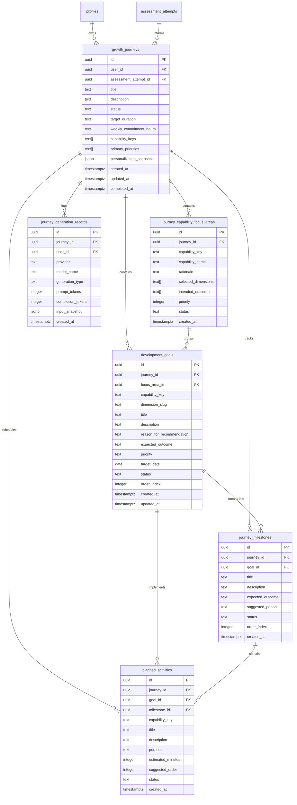

# OBHASH — Growth Journey Database Reference

**Phase:** Phase 4 of 8 (Personalized Growth Journey)  
**Migration ID:** `20261120030000_phase4_growth_journeys.sql`  

---

## 1. Relational Entity-Relationship Diagram

---

## 2. Row Level Security (RLS) Policies

All tables in Phase 4 enforce PostgreSQL Row Level Security:

1. `growth_journeys`:
   - `auth.uid() = user_id` for all operations (`SELECT`, `INSERT`, `UPDATE`, `DELETE`).
2. `journey_capability_focus_areas`, `development_goals`, `journey_milestones`, `planned_activities`:
   - Protected via `EXISTS` subqueries verifying that the associated `growth_journeys.user_id = auth.uid()`.
3. `journey_generation_records`:
   - `auth.uid() = user_id` for `SELECT`.
