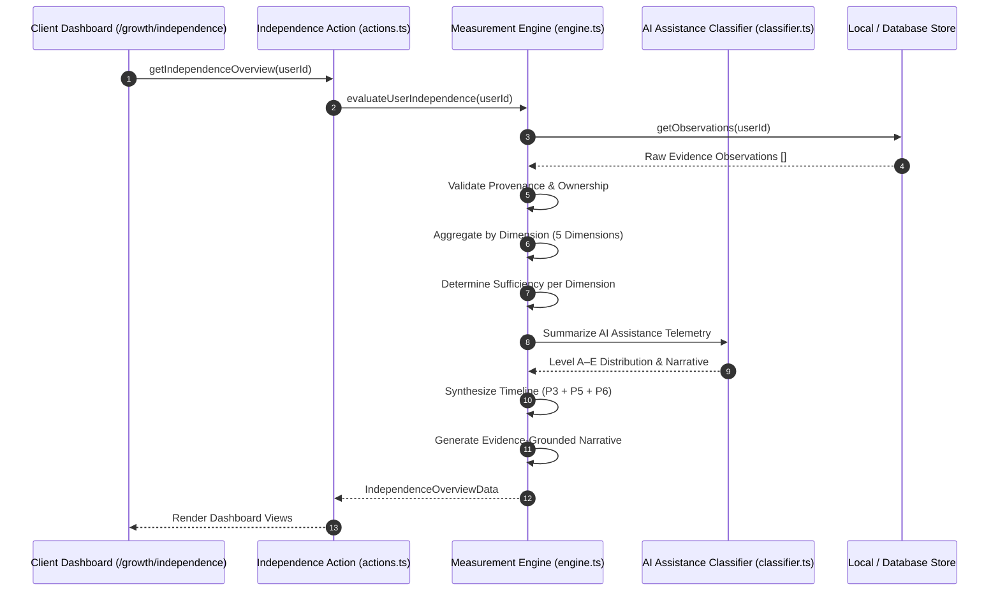

# OBHASH Independence Measurement Engine

## 1. Engine Architecture & Workflow

The Independence Measurement Engine evaluates learner evidence through a transparent, 10-step server-side pipeline:

---

## 2. Aggregation & Weighting Logic

### 2.1 Sufficiency Formula
Sufficiency is determined per dimension by the count of verifiable observations:
- `0 observations` -> `insufficient` ("Insufficient Evidence")
- `1-2 observations` -> `emerging` ("Emerging Evidence")
- `3-4 observations` -> `developing` ("Developing Evidence")
- `5+ observations` -> `consistent` ("Consistent Evidence")

Overall user sufficiency (`hasSufficientEvidence`) requires at least 2 qualified observations across the entire profile.

### 2.2 Rejection of Arbitrary Numeric Weighting
OBHASH deliberately eschews arbitrary mathematical algorithms (such as assigning 35% weight to reflections and 65% to challenges) because such weighting schemes produce misleading pseudo-precision. Instead:
- Behavior counts are presented transparently alongside exact quotes.
- The predominant AI assistance tier is reported with exact counts (e.g. 5 Level A, 2 Level B).
- The narrative explicitly highlights what has been observed and what remains unverified.

---

## 3. Capability Development Over Time & Comparability Safeguards

When comparing diagnostic assessments (Phase 3) with practical challenges (Phase 6), the engine enforces strict comparability verification:
- **Baseline Assessments:** Evaluated structured answers to standardized scenarios under diagnostic constraints.
- **Practice Challenges:** Evaluated open-ended deliverables in ambiguous, real-world contexts.
- **Safeguard Rule:** If the task format or rubric version differs, the engine flags `isComparable: false` and explicitly includes an explanatory disclosure:
  > *"Note on comparability: Challenge practice evaluated open-ended real-world deliverables, whereas baseline was a structured diagnostic. Improvement indicates practical fluency rather than a direct psychometric shift."*

---

## 4. Anti-Hallucination & Uncertainty Safeguards

1. **Untrusted Input Sanitation:** All submissions and disclosures are sanitized server-side.
2. **Grounding Requirement:** The engine will not generate an observation without a concrete `sourceRecordId` and `evidenceQuote`.
3. **Transparent Limitations Banner:** Every report concludes with an immutable limitations notice:
   > *"This assessment is an operational diagnostic based on observed workspace telemetry and user-submitted work. It is not an accredited psychometric score or universal intelligence rating. Independence fluctuates across domains and contexts."*
