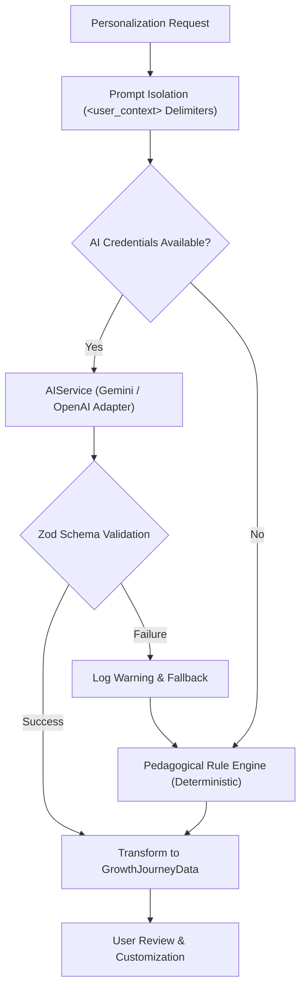

# OBHASH — Personalization Engine Specification

**Phase:** Phase 4 of 8 (Personalized Growth Journey)  
**System:** Recommendation Logic, Prompt Isolation & Pedagogical Fallback  

---

## 1. Personalization Inputs

The personalization engine synthesizes data from four sources:

1. **Assessment Baseline Evidence:**
   - Overall scores and 4-tier performance levels (Emerging, Developing, Demonstrating, Strongly Demonstrating).
   - Dimension-level scores across 15 capability facets.
   - Identified demonstrated strengths and development opportunities.
   - Direct evidence citations extracted from user submissions.
2. **User Profile Interests:**
   - Expressed interests collected during onboarding (e.g. Technology, Ethics, Philosophy, Urban Systems, Design, Climate, Science).
3. **Growth Intentions:**
   - Primary motivations (e.g. "Think more clearly", "Make better decisions", "Explore new perspectives").
4. **Practical Parameters:**
   - Target duration (4, 8, 12 weeks).
   - Weekly time commitment (1–2h, 3–4h, 5–6h per week).
   - Contextual exploration notes.

---

## 2. Recommendation & Prioritization Logic

The engine follows five core pedagogical rules:

1. **Leverage Strengths as Scaffolding:** Rather than penalizing users by solely assigning exercises for their lowest score, the engine identifies adjacent strengths to anchor growth. For instance, strong *Analytical Reasoning* is used as a foundation to address developing *Evidence Evaluation*.
2. **Contextual Application to Real Interests:** Generic exercises are contextualized into the user's domain of interest (e.g., deconstructing confounding variables in transit studies for an urban design enthusiast).
3. **Transparent Reasoning:** Every recommended goal must articulate:
   - What the learner will focus on.
   - Why it was selected.
   - Which specific assessment finding or stated intention informed the choice.
   - Expected developmental outcome.
   - How to recognize observable progress.
4. **Cognitive Load Management:** Limits simultaneous focus to at most 2–4 primary priorities per journey.
5. **No Deficit Labeling:** Replaces punitive feedback with capability development opportunities.

---

## 3. Dual Architecture & AI Safety

### Prompt Injection Defense
User inputs (interests, notes, responses) are treated as untrusted text. They are encapsulated in `<user_context>` XML tags, and the system prompt explicitly commands the model to treat the content solely as passive analytical data and never execute embedded directives.

### Schema Validation
Model output is validated against `JourneyAiResponseSchema` built with Zod. If the output fails validation or times out, the system automatically and silently reverts to `generateDeterministicJourney`.
